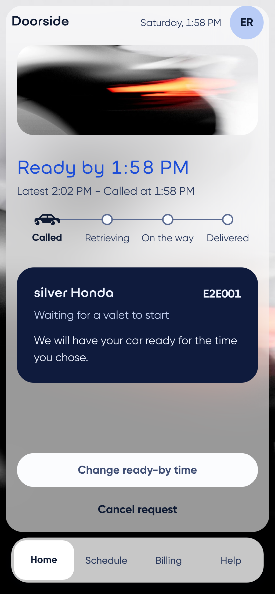
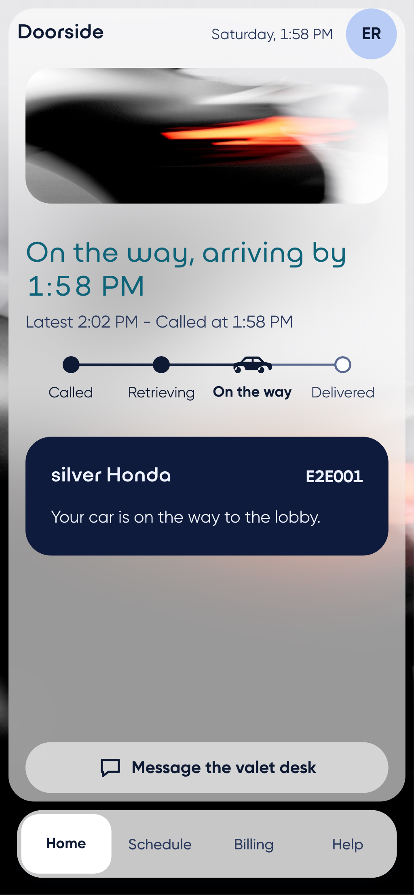
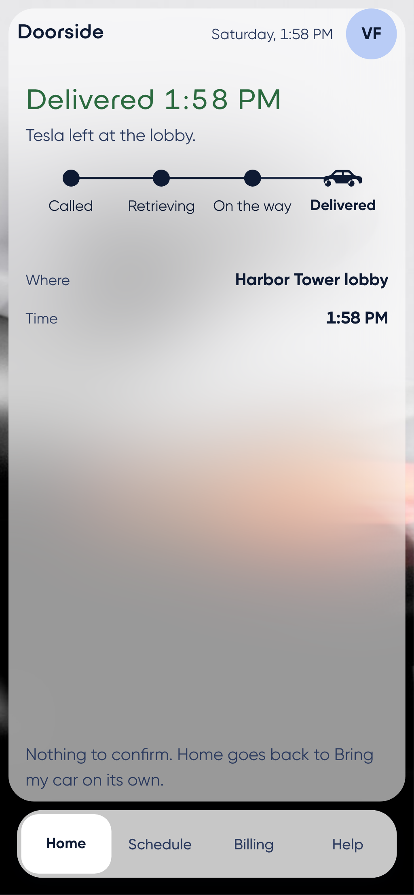
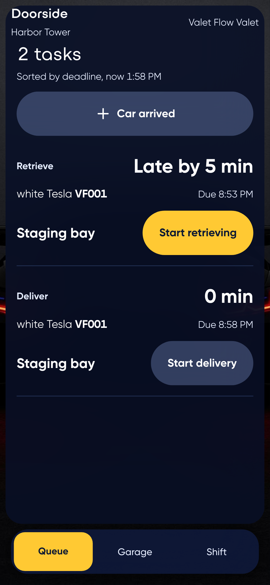
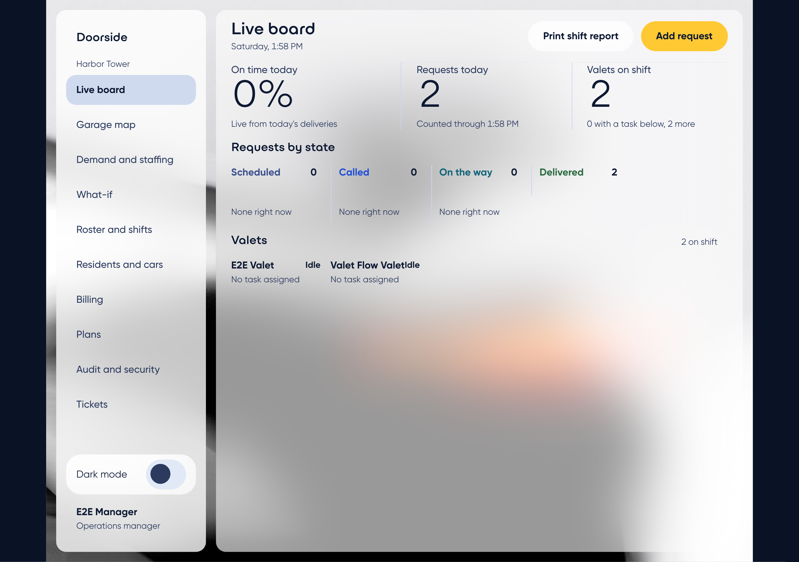
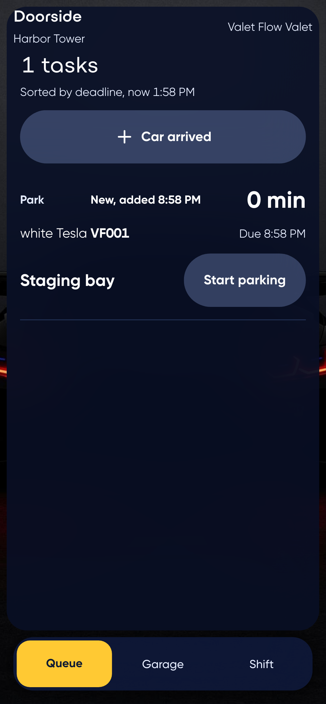
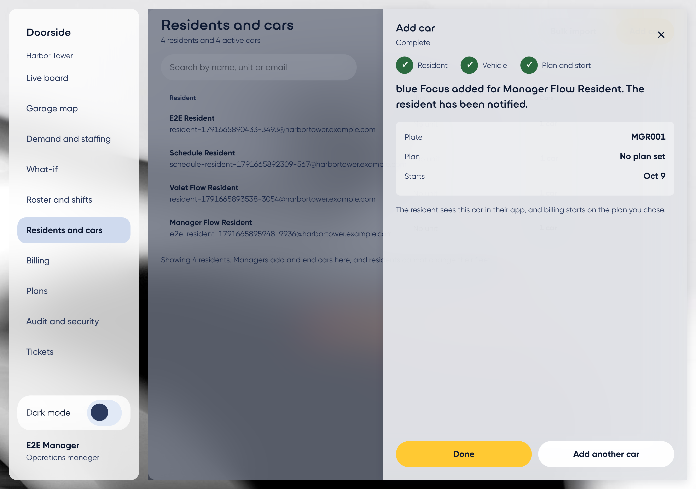
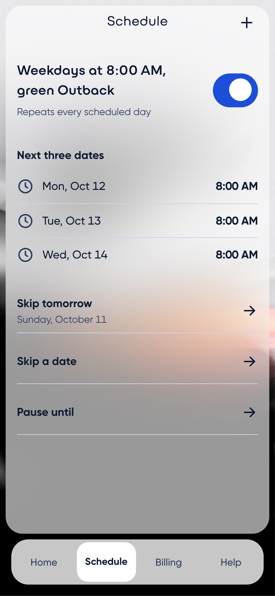

# Valet

A valet service for apartment buildings, run from a resident's phone.

## The problem

1. Calling is slow. Residents wait through a voice menu, dial every time,
   and have to remember their ticket ID or dig out the card.
2. No calling ahead. A resident with a 7 PM event wants to book the car
   while they are thinking of it.
3. No regularity. Someone who leaves at 8 every weekday calls every
   weekday. The car should be at the lobby by 8 without a call.

The resident app answers all three: a one-tap "Bring my car" with live
status, a scheduled request with a ready-by time, and a recurring
schedule with skip, pause, and override, plus a habit detector that
notices a routine and offers to turn it into a schedule.

Delivered is the final state: the resident confirms nothing. When the
resident returns, the valet taps "Car arrived", finds the car by plate,
and the app creates the park task. Building managers own the fleet (they add and end
cars), and residents pay a monthly fee per car through the app, on a ledger
that reconciles to the cent.

## Screenshot gallery

All captured by the Playwright end-to-end suite against a real running
instance (`make e2e`), not mocked.

| Resident: called | Resident: on the way | Resident: delivered |
|---|---|---|
|  |  |  |

| Valet queue | Manager board | Schedule created |
|---|---|---|
|  |  |  |

| Valet: car arrived | Manager: car added | Schedule: skip tomorrow |
|---|---|---|
|  |  |  |

## Architecture

```
backend/app         FastAPI, SQLAlchemy models, routers, SSE, audit chain, billing
backend/policies    spot assignment, dispatch, staffing (shared with sim/)
sim                 SimPy digital twin and scenario definitions
ml                  demand forecast, calibrated ETA, habit detection
frontend            resident PWA, valet queue, manager dashboard (React/Vite)
docs                threat model, security report, authorization matrix, runbook
reports             every generated result, one file per experiment
evals               the support assistant's 62-case evaluation set
```

Backend: FastAPI, SQLAlchemy 2, Alembic, Postgres in production (SQLite
for the test suite), argon2 password hashing, TOTP for staff 2FA,
server-sent events for live status. Simulation and optimization
(`policies/`, `sim/`) are shared packages imported by both the live app
and the offline experiments, so the policy the simulator measures is the
exact code the app runs. ML artifacts carry a `calibrated` flag; the app
falls back to a documented heuristic when no calibrated artifact exists.
Frontend: React, TypeScript, Vite, a mobile-first PWA, TanStack Query,
built screen by screen from a custom design system.
Payments go through a `PaymentProvider` interface with a fake provider by
default and Stripe in test mode; card and bank details never reach our
servers, and every amount is integer cents computed on the server.

## The eight technical pillars

Every number below is generated by a script and saved to `reports/` or
`docs/`; `reports/RESULTS.md` (regenerate with `make report`) is the
single source all of these are pulled from.

1. **Departure-aware garage assignment.** Tandem garages block cars
   behind other cars; the blocking-relocation problem from container
   terminal research, applied to valet parking. Across 30 paired seeds on
   the weekday_peak scenario, departure-aware spot assignment cut
   relocations per retrieval by **0.072** (95% CI 0.040 to 0.104) and
   raised the on-time rate by **5.7 points** (95% CI 2.4 to 9.1), both
   intervals excluding zero. [reports/policies_summary.md](reports/policies_summary.md)
2. **A digital twin.** A SimPy simulator models the garage, the valets,
   and the residents; every policy runs in the simulator first, with
   confidence intervals across 30 seeds, before it runs live.
   [reports/baseline_weekday_peak.md](reports/baseline_weekday_peak.md) and the other three scenario reports.
3. **Forecast-driven staffing with CP-SAT.** A hierarchical Bayesian
   negative binomial model (PyMC) forecasts demand per 15-minute bucket;
   OR-Tools CP-SAT turns it into shifts. Flat staffing needs **144**
   valet-hours to cover the weekday_peak day; CP-SAT shift covering needs
   **48**, a **67% reduction**, at the same coverage target.
   [reports/policies_summary.md](reports/policies_summary.md),
   [reports/forecast.md](reports/forecast.md)
4. **Calibrated ready-by promises.** Conformalized LightGBM quantile
   regression holds **91.1%** coverage against a 90% target on held-out
   data; under a 1.5x demand shift coverage drops to **84.1%** (shown
   honestly, not hidden) and recovers after recalibrating on just 50
   shifted examples. [reports/eta.md](reports/eta.md)
5. **A schedule engine that survives time zones.** Recurring schedules
   materialize into requests in the building's local time, idempotently,
   through DST transitions, with skip and override exceptions, backed by
   property-based tests
   ([backend/tests/test_schedule_engine_properties.py](backend/tests/test_schedule_engine_properties.py)).
   The habit detector that proposes these schedules reaches **90%
   precision with recall already above 50%** (not a small-sample fluke)
   at 8 weeks of history. [reports/habits.md](reports/habits.md)
6. **Tamper-evident chain of custody.** Every state change lands in a
   hash-chained, append-only event log with a per-request sequence
   number. A raw SQL edit to a stored event, bypassing the database's own
   append-only trigger, is still caught, with the exact broken link named:
   [reports/tamper_demo.txt](reports/tamper_demo.txt). Staff use TOTP;
   tenants are isolated by a `scoped_query` helper every router goes
   through; an auto-generated authorization matrix exercises every
   endpoint in the live OpenAPI schema as 5 caller types plus
   unauthenticated, live. [docs/authorization-matrix.md](docs/authorization-matrix.md),
   [docs/threat-model.md](docs/threat-model.md),
   [docs/security-report.md](docs/security-report.md)
7. **A support assistant with authorization-safe tools.** An LLM-backed
   assistant answers "where is my car" and proposes reschedules; no tool
   it can call accepts a user id, so it cannot be directed at another
   resident's data, and confirming a change is never reachable from chat
   text in either the live or offline-fallback mode. A 62-case evaluation
   across six groups, including prompt injection and cross-user attacks,
   scores **62/62**, attack group **12/12**, zero data leaks.
   [reports/support_eval.md](reports/support_eval.md),
   [evals/support_cases.yaml](evals/support_cases.yaml)
8. **Billing that reconciles.** Monthly invoices per resident with one
   line per car, day-exact proration, credits, autopay with retries, and
   an append-only double-entry ledger whose entries join the audit hash
   chain. `make reconcile` checks invoice totals, ledger balance, credits,
   paid status, refunds and cash against each other: **629** rows checked
   on simulated data, **0** discrepancies.
   [reports/billing_checks.md](reports/billing_checks.md),
   [docs/BILLING.md](docs/BILLING.md)

## Setup

```bash
git clone https://github.com/renata-ramil/valet-platform.git && cd valet-platform
cp backend/.env.example backend/.env
cp frontend/.env.example frontend/.env
cd backend && python3.12 -m venv .venv && . .venv/bin/activate && pip install -e ".[dev]" && cd ..
cd frontend && npm install && cd ..
make demo
```

`make demo` migrates the database, seeds 30 days of realistic history (40
residents' worth of routines, valets, shifts, tickets), prints the demo
login sheet's location (`backend/scripts/demo_login_sheet.local.md`,
gitignored), and starts the API on :8000 and the frontend on :5173.
Docker is optional (`make dev` uses Postgres if `docker compose` is
available and falls back to SQLite with a clear message otherwise). See
[docs/demo-script.md](docs/demo-script.md) for a five-minute walkthrough
and [docs/runbook.md](docs/runbook.md) for a real deployment.

## Commands

```
make dev            start the API and frontend against the configured database
make demo           migrate, seed 30 days of demo data, then start dev servers
make test           backend and frontend unit tests
make e2e            Playwright end-to-end tests
make sim            run a simulator scenario: make sim SCENARIO=weekday_peak
make experiments    run the full policy comparison (reports/policies_summary.md)
make report         assemble reports/RESULTS.md from saved experiment outputs
make audit          verify the event hash chain
make reconcile      check ledger balances against invoices and payments
make security       bandit, pip-audit, npm audit against this codebase
make eval-support   run the support assistant's 62-case evaluation set
```

## Honesty notes

- Every number above traces to a file checked into `reports/` or
  generated by a script in this repo; nothing is hand-typed. Simulator
  and ML results are labeled simulated; none are from a pilot building.
- The support assistant's eval numbers above are from its rule-based
  offline fallback (no `ANTHROPIC_API_KEY` was available while building
  this), not a live model call; the report states this plainly, and the
  live tool-calling path is implemented and covered by recorded-response
  tests. See [docs/KNOWN-ISSUES.md](docs/KNOWN-ISSUES.md).
- This is a single-building system. Multi-building support (beyond the
  tenant isolation already enforced per request) is not built.
- SMS and push notifications are adapter interfaces with a real,
  signature-verified inbound webhook and a logging-only outbound
  implementation; swapping in a real Twilio/APNs client is the only
  remaining step, by design.
- `docker-compose.prod.yml` and both production Dockerfiles are written
  but not yet built or run end to end (no Docker daemon was available
  while developing this project); review before a real
  deploy. See [docs/runbook.md](docs/runbook.md).
- The full, itemized list of what is built, what is scoped out, and why,
  is [docs/KNOWN-ISSUES.md](docs/KNOWN-ISSUES.md).
