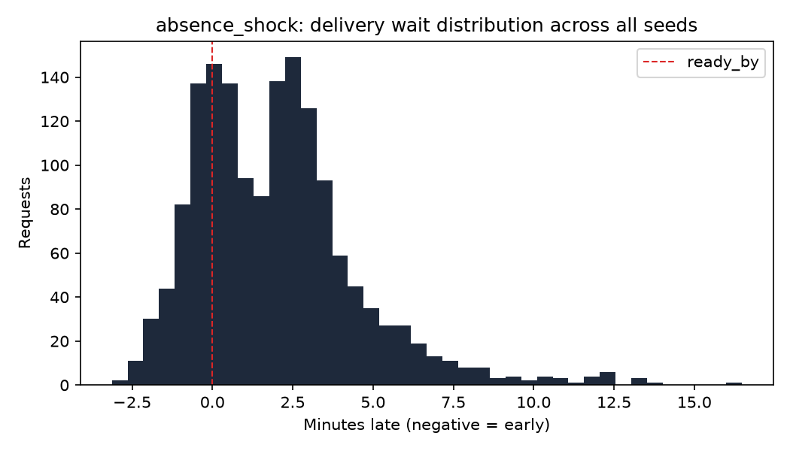

# Baseline results: absence_shock

All numbers below are simulated, from the digital twin in sim/, not from a
pilot building. They use the baseline policies: nearest-free spot assignment
and a deadline-priority dispatcher, across 30 random seeds.

## Metrics

| Metric | Value | 95% CI |
|---|---|---|
| Requests delivered (all seeds) | 1559 | |
| Relocations per retrieval | 0.505 | 0.457 to 0.551 |
| Wait p50 (seconds, negative = early) | 104 | 79.8 to 128 |
| Wait p95 (seconds) | 317 | 272 to 368 |
| On-time rate, scheduled requests | 32.3% | 27.1% to 37.9% |
| Valet utilization | 2.5% | 2.3% to 2.7% |

On-time rate is computed over scheduled requests only (commuter and evening
sources); on-demand requests have no advance ready-by to be early or late
against by construction.
