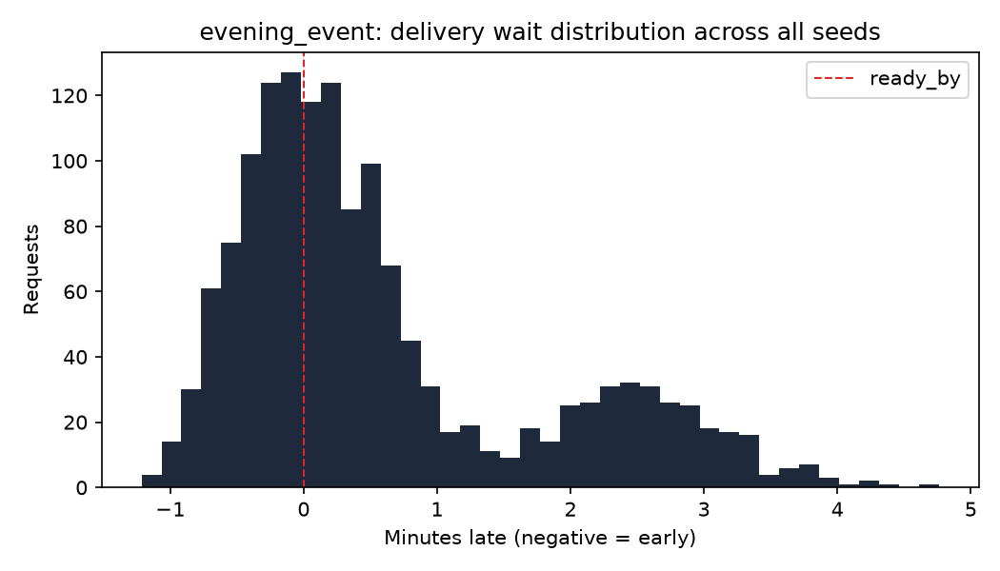

# Baseline results: evening_event

All numbers below are simulated, from the digital twin in sim/, not from a
pilot building. They use the baseline policies: nearest-free spot assignment
and a deadline-priority dispatcher, across 30 random seeds.

## Metrics

| Metric | Value | 95% CI |
|---|---|---|
| Requests delivered (all seeds) | 1467 | |
| Relocations per retrieval | 0.226 | 0.221 to 0.231 |
| Wait p50 (seconds, negative = early) | 14.1 | 10.9 to 17.6 |
| Wait p95 (seconds) | 173 | 167 to 181 |
| On-time rate, scheduled requests | 46.8% | 44.4% to 49.3% |
| Valet utilization | 1.6% | 1.5% to 1.6% |

On-time rate is computed over scheduled requests only (commuter and evening
sources); on-demand requests have no advance ready-by to be early or late
against by construction.
