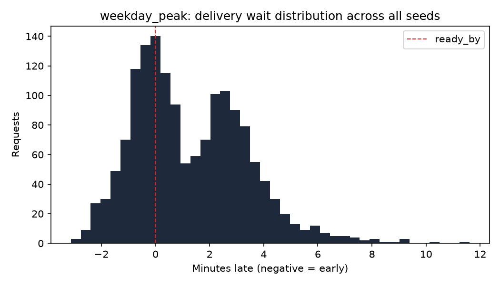

# Baseline results: weekday_peak

All numbers below are simulated, from the digital twin in sim/, not from a
pilot building. They use the baseline policies: nearest-free spot assignment
and a deadline-priority dispatcher, across 30 random seeds.

## Metrics

| Metric | Value | 95% CI |
|---|---|---|
| Requests delivered (all seeds) | 1559 | |
| Relocations per retrieval | 0.512 | 0.466 to 0.559 |
| Wait p50 (seconds, negative = early) | 60.3 | 40.9 to 82.1 |
| Wait p95 (seconds) | 261 | 235 to 291 |
| On-time rate, scheduled requests | 45.0% | 39.7% to 50.3% |
| Valet utilization | 2.0% | 1.9% to 2.1% |

On-time rate is computed over scheduled requests only (commuter and evening
sources); on-demand requests have no advance ready-by to be early or late
against by construction.
