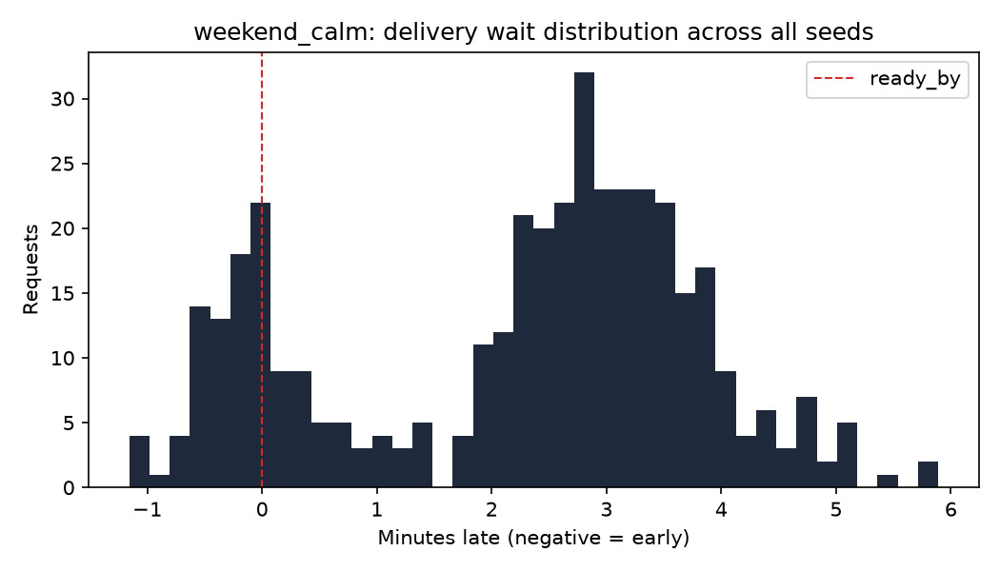

# Baseline results: weekend_calm

All numbers below are simulated, from the digital twin in sim/, not from a
pilot building. They use the baseline policies: nearest-free spot assignment
and a deadline-priority dispatcher, across 30 random seeds.

## Metrics

| Metric | Value | 95% CI |
|---|---|---|
| Requests delivered (all seeds) | 403 | |
| Relocations per retrieval | 1.04 | 0.995 to 1.07 |
| Wait p50 (seconds, negative = early) | 151 | 137 to 162 |
| Wait p95 (seconds) | 245 | 235 to 255 |
| On-time rate, scheduled requests | 54.7% | 48.3% to 60.9% |
| Valet utilization | 1.0% | 0.9% to 1.1% |

On-time rate is computed over scheduled requests only (commuter and evening
sources); on-demand requests have no advance ready-by to be early or late
against by construction.
