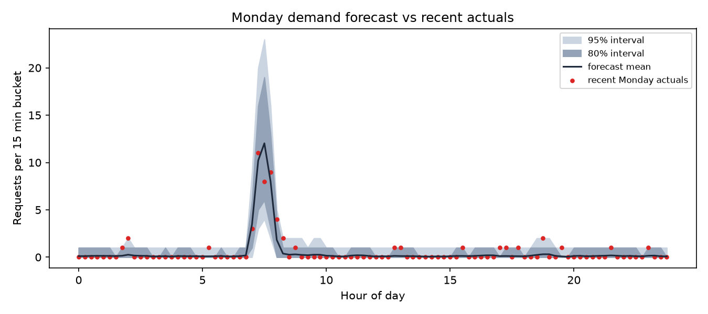

# Demand forecast

All numbers below are from the hierarchical negative binomial model trained
on 12 weeks of simulated request history (ml/data/history_demand.parquet),
labeled with a synthetic origin. Not from a pilot building.

## Rolling-origin backtest (last 4 weeks, one fold per week)

| Fold | NB WAPE | Seasonal naive WAPE | LightGBM WAPE | 80% coverage | 95% coverage | max R-hat | divergences |
|---|---|---|---|---|---|---|---|
| 1 | 0.801 | 0.809 | 0.802 | 95.5% | 99.6% | 1.049 | 0 |
| 2 | 0.781 | 0.747 | 0.754 | 94.2% | 97.8% | 1.056 | 0 |
| 3 | 0.720 | 0.709 | 0.718 | 95.5% | 99.3% | 1.025 | 0 |
| 4 | 0.751 | 0.746 | 0.745 | 92.4% | 99.0% | 1.070 | 0 |

Target coverage is 80% and 95%. Max R-hat across folds is 1.070 with zero
divergences in every fold, which is an acceptable (if not perfect) level of
convergence; an earlier version of this model had R-hat as high as 2.2 from an
intercept/random-walk confound, fixed by mean-centering the smooth time-of-day
component (see docs/KNOWN-ISSUES.md). Coverage meets or exceeds target in every
fold, meaning the intervals are conservative (wider than strictly necessary)
rather than too narrow; the point forecast (WAPE) is roughly on par with both
baselines, so this model's main advantage here is the calibrated uncertainty
band, not a sharper point prediction.

## Staffing from the forecast vs ground-truth demand

- CP-SAT staffing from the forecast's weekday-average demand: 48.0 valet-hours, 3 buckets under-covered
- Flat staffing (all valets all day) for comparison: 144.0 valet-hours

See reports/policies_summary.md for the ground-truth-demand staffing comparison
(48.0 valet-hours on weekday_peak); the forecast-driven number
above is the same CP-SAT staffer fed the model's prediction instead of the
simulator's ground truth, so the gap between them reflects forecast error, not
a different optimizer.
