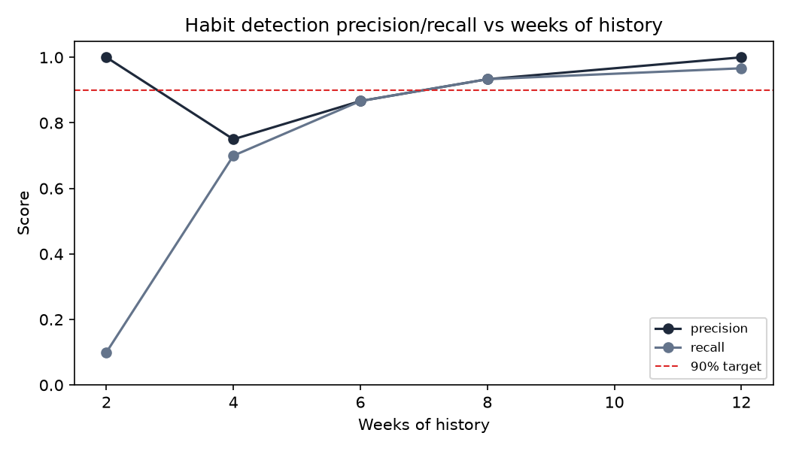

# Habit suggestions

Evaluated on simulated residents with known routines (half with a fixed
weekday/time routine, half pure noise as a control), not real residents.

| Weeks of history | Precision | Recall |
|---|---|---|
| 2 | 100.0% | 10.0% |
| 4 | 75.0% | 70.0% |
| 6 | 86.7% | 86.7% |
| 8 | 93.3% | 93.3% |
| 12 | 100.0% | 96.7% |

Reaches 90% precision (with recall already above 50%, so it isn't a small-sample fluke) at 8 weeks of history.

## Integration

`GET /suggestions` runs the same beta-binomial detector against a
resident's own request history and returns proposed schedules; the
resident app shows a card offering to create each one.
